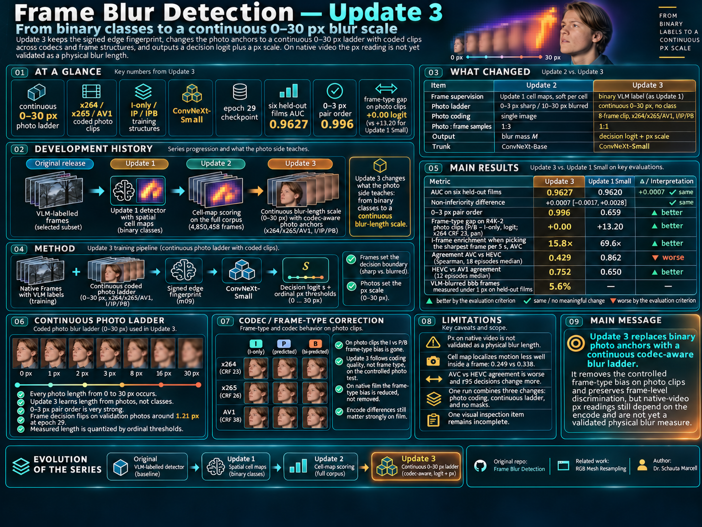

# Frame Blur Detection — Update 3



*The portrait in the infographic illustrates a frame of the test series, Young Royals, which is not training material.
The training photos and frames are not published.*

The fourth model of [Frame Blur Detection](https://github.com/mschauta/frame-blur-detection), after
[Update 1](https://github.com/mschauta/frame-blur-detection-update-1) and
[Update 2](https://github.com/mschauta/frame-blur-detection-update-2). The input is unchanged: the signed edge
fingerprint of the [RGB Mesh Resampling](https://github.com/mschauta/rgb-mesh-resampling) `m09` reconstruction. What
changes is what the photo anchors teach. The earlier models learned a class from them: sharp or blurred. Update 3
learns a length from them, 0 to 30 px of camera blur. The result is an ordinal score calibrated on synthetic blur on
coded photos. On native video, reading it as a physical blur length is not validated.

**Status, 2026-10-31: trained; the evaluation is complete except for one visual inspection.** The run finished, and
epoch 29 is the checkpoint fixed in advance. Items 1, 2, 3, 5 and 6 of the evaluation registered before the run were
carried out, item 5 on all its 18 episodes in AVC and HEVC and 12 in AV1. One is incomplete:

- **Item 4:** the cell-level motion witness was run, but the author's visual inspection of the cell maps was not.

All three proposed criteria are met. Two things came out worse than Update 1 Small: the cell map inside a frame, and
the agreement between the AVC and the 10-bit encodes on film. The full report is
[experiments/u3r3_gop_ladder/REPORT.md](experiments/u3r3_gop_ladder/REPORT.md).

The criteria measure a controlled improvement on photos and non-inferiority on frames. They do not show that Update 3
is better than Update 1 Small overall.

## Results

The control is Update 1 Small (release v1.1): the same frames, the same start and the same schedule.

| evaluation item | Update 3 | Update 1 Small | proposed criterion |
|---|---|---|---|
| 1. codec gap on R4K-2 photo clips (P/B − I-only, logit; x264 CRF 23, pan) | +0.00 | +13.20 | **met** |
| 2. AUC on six held-out films | 0.9627 | 0.9620 | **met:** +0.0007 [−0.0017, +0.0028] |
| 3(a). pair order 0–3 px, Update 1 photo ladder | 0.996 | 0.659 | **met** |
| 3(b). px MAE / Spearman, x264 / x265 / AV1 × I-only / IPB | 1.47–1.52 px / 0.990–0.995 | no px | – |
| 4. cell map against the measured motion, inside a frame | 0.249 | 0.338 | – (worse) |
| 5. agreement of the AVC and HEVC encodes of the same frames (Spearman; 18 episodes, median and range) | 0.429 (0.290–0.569) | 0.862 (0.778–0.902) | – (worse) |
| 5. r95 decisions that change between the AVC and HEVC encodes (18 episodes) | 29.7% (22.8–42.3) | 20.6% (16.3–24.0) | – (worse) |
| 5. agreement of the HEVC and AV1 encodes (Spearman; 12 episodes) | 0.752 (0.633–0.841) | 0.650 (0.577–0.913) | – (better) |
| 5. I-frame enrichment when picking the sharpest frame per 5 s, AVC (18 episodes) | 15.8× (10.7–25.4) | 69.6× (56.7–81.9) | – |
| 6. VLM-blurred (`bbb`) frames measured under 1 px, held-out films | 5.6% | no px | (R4T-1: 17–29%) |

- **On photo clips the frame-type bias is gone.** Update 3 reads an I-frame and the P- or B-frames of the same clip
  alike, in all three codecs. Where an I-only coding is worse (lower PSNR), it reads those frames as blurrier: it
  follows the coding quality, not the frame type.
- **The frame decision is not inferior by the protocol's margin, and no gain is shown.** On six held-out films the
  AUC difference is +0.0007 [−0.0017, +0.0028]. Sharp frames kept are level at r90 and r95, and lower at r98: −2.13
  [−3.13, −1.22] points. On the three test films alone they are also lower at r95: −1.16 [−2.03, −0.42].
- **The px scale holds on photos** in every codec and structure tested. On native frames the VLM-blurred frames no
  longer read under 1 px (5.6% of `bbb`, against 17–29% for the photo-only R4T-1). Inside one VLM code, the cell
  readouts order the frames by measured motion as well as Update 1 Small's do. This does not validate the px as a
  physical length on video: the order of the codes is partly met by construction, steady pans read almost 0 px, and
  the reading changes with the encode.
- **On film (18 episodes of one series, Young Royals) the frame-type bias is reduced, not removed, and the encode still matters.**
  - On the AVC files (x264, CRF 16–17) the share called sharp at r95 is nearly level across frame types: I 25%, P 19%,
    B 23% (Update 1 Small: I 84%, P 22%, B 28%). The I-frame enrichment falls to about a quarter of Update 1 Small's, and is still large.
  - In all 18 episodes both models read the AVC file blurrier than the HEVC file of the same frames: by +2.78 logits for
    Update 3 (+1.00 to +5.57) and +1.81 for Update 1 Small (+1.50 to +2.17). Update 3 ranks the frames of the two much less
    alike, and changes more r95 decisions (29.7% against 20.6%).
  - Between HEVC and AV1 Update 3 is the steadier (Spearman 0.752 against 0.650; decisions 17.1% against 27.0%).
  - Update 3's px depend on the file, not only the codec: its median on AVC ranges from 0.21 to 3.15 px over the
    episodes, with similar x264 settings. The cause is not established.
  - The two episodes published first were not typical, by a rule recorded before the full round: the direction holds,
    but they overstated the level and ranking difference and understated the decision changes.
  - In a one-minute re-encoding test, x264 coding of film frames raised the reading step by step with falling
    quality, by 0.6 px even at 43 dB. x265 at the same rate raised it less. A follow-up 2 × 2 test points to the codec
    for Update 1 Small. For Update 3 it does not separate the codec from the bit depth. The encodes are second
    generation, from an HEVC source (report, item 5).
  - Update 1 Small reacts the same way in logits and crosses its decision boundary, but keeps its ranking better.
  - Between two H.264 releases of 31 corpus films, Update 3 agrees as well as Update 1 Small (Spearman 0.801 against
    0.793).
- **The cell map localises motion less well inside a frame** (0.249 against 0.338).
- **The 95% point is very strict.** Its threshold sits at 0.05 px, so it calls 21% of coded 0 px photos blurred
  (Update 1 Small: 4%). That is as strict as on the sharp validation frames, where it keeps 79%.

One run carries three changes (photo coding, continuous ladder, no masks), so none of these results can be assigned
to one of them.

## Update 1 and Update 3 on the whole corpus

Added on 2026-11-02. Both models scored all 5,010,602 corpus frames, and the comparison reads those stored scores and
cell maps. The control here is Update 1 **Base**, not Small, because only the Base has corpus scores, so the architecture and
the recipe cannot be separated. The full report is
[experiments/u3_corpus_comparison/README.md](experiments/u3_corpus_comparison/README.md).

- **The decisions are nearly the same, and no witness picks a winner.** The Spearman of the frame logits is 0.938 (0.861
  inside a shot), 93.7% of the r95 decisions agree, and strong contradictions are 3.4 per thousand. At equal sharp share
  Update 3 is slightly ahead on motion inside a shot and on stability over the corpus; on the six held-out films those intervals include 0, except for decision flips at r90.
- **Update 3 is stricter at r98:** 48.5% sharp against 50.9%, and 67.6% of the shots have a frame below r98 against 71.2%. At r90 the two are level.
- **The largest difference is what the frame score is made of.** Without their red cells (logit ≥ 0), 60.5% of Update 3's frames between r95 and r90 stay above its r98, against 20.1% for Update 1 Base.
  Update 3's score also responds to the wide field of cells below logit 0. In the shots the motion selection emptied, a weak proxy for close-ups, the shares are 80.5% and 32.9%.
- **The whole cell map follows motion better in Update 1 Base** (0.239 against 0.175 inside a frame). On sharp frames both put their few red cells on the most moving parts (0.83 and 0.82), though rarely on the same cells.
- **The bands between the thresholds form a usable scale.** Below r98, r98–r95, r95–r90 and from r90, the VLM's blurred codes (`bsb`, `bbb`) make up 0.6 / 4.2 / 12.0 / 71.8% of the labelled frames in Update 3. The r95–r90 band is the mixed one.
- **On three films above 23 Mbps Update 3's r98 share falls** (at worst 31.8% against 60.6%) while r90 does not move. Three films are a lead, not a result.

## Weights

`update3_small_p99_ep029.pt` (130 MB; SHA-256 `6cd68d831b63fdc5f8a6c02cef777c89fbd273daed4d3f47a3c134a37421fbf2`),
ConvNeXt-Small, epoch 29 of 30. The trunk is the original ConvNeXt (v1; Liu et al., 2022, as implemented in torchvision), not ConvNeXt V2.
The file is attached to the [releases](../../releases) (not stored in the repository).

- **The format is Update 1's.** The state dict leaves out the two ordinal parameters, so Update 1's loader
  (`blurdetect`) and `classify.py` read the file unchanged. The image logit is the frame decision.
- **Thresholds** from the validation frames: r90 / r95 / r98 = 0.2362 / 0.0321 / 0.0078 on the sigmoid score. On the px
  scale these are 0.355 / 0.052 / 0.013 px.
- **The px reading** needs the ordinal offsets in `meta["ordinal"]`:

```python
import numpy as np
from blurdetect import load_detector          # from frame-blur-detection-update-1

model, meta = load_detector("weights/update3_small_p99_ep029.pt", "cuda")
T = np.array(meta["ordinal"]["T"])            # 0.5, 1, 2, ... 24, 30 px
b = np.array(meta["ordinal"]["b"])            # the learned offsets

def px(logit):                                # image logit, or a cell of out["local"]
    return float((np.diff(T, prepend=0.0) / (1 + np.exp(-(logit - b)))).sum())
```

## The system

[SYSTEM.md](SYSTEM.md) is the full description of the system. For every part it says what the part was used for and
what it did, measured on the models of the series, and how to set it:

- **The generations:** Generation 1 learns from VLM-labelled frames and the photo ladder; Generation 2 learns from
  Generation 1's cell maps of every frame and the photo ladder. It covers what a generation inherits, what it gets
  anew, how the dependence on the VLM changes, and whether the student has surpassed its teacher so far. Also the
  VLM's role as a binary bootstrap that the later steps transform, and what a VLM-free Generation 1 would need
  (not yet tried).
- **Binary, length or blur mass:** whether blur can be a class at all, what each kind of output can say, where each
  fails, and which separates most cleanly.
- **The parts:** the dataset of native frames; the VLM teacher; the non-learned motion measurement; the frame
  selection; the photo ladder as etalon and regulariser, including what each step of the coding chain simulates;
  the signed edge fingerprint; the detector.
- **Training:** repetition against every-sample-new; the learning rate, schedule and noise; what is learned fast
  and what slowly; the choice of checkpoint; Small against Base.
- **Readouts and thresholds per model,** what each model measures and how well, the distillation, and the witnesses.
- **What generalises and what does not.**
- **A step-by-step recipe** for building an equivalent dataset and model.

## Development history, continued

Sections 1–8 of the history are in Update 1's README, section 9 in Update 2's. In short:

- A frozen vision-language model (VLM) labelled about one million video frames.
- ConvNeXt detectors learned the decision from the edge fingerprint, with one logit per 16 px cell.
- Synthetic photos with a known amount of added camera blur anchored the scale.

### 10. Update 3: from a class to a length

#### Update 1: a binary decision, a two-peaked photo ladder

- **Frames:** 589,663 selected frames, each with its binary VLM label.
- **Photos:** two classes with a gap between them:
  - sharp: 0, 1, 2 or 3 px of added camera blur;
  - blurred: 16, 20, 24 or 30 px.

  The gap was deliberate. With no transition between the two classes, the separation is easy to learn, and the
  photos agree with the binary frame labels.
- **The threshold:** the network gives a score, and the operating points (r90 / r95 / r98) are read off the
  validation frames.

#### Update 2: the predecessor's maps, a stricter ladder

- **The selection:** Update 1 scored the 5.01-million-frame corpus and gave every frame a cell map.
- **Frames:** Update 2 learned those maps on every frame of the training videos (4,850,458 frames), as soft targets
  per cell. No VLM label was used in training.
- **Photos:** the ladder became stricter on the blurred side, which now starts at 10 px instead of 16 px. The gap
  narrowed to 3–10 px, so moderate blur is pushed towards "blurred".
- **The frame value:** a fixed blur mass, with the threshold chosen when filtering.
- **Inherited bias:** because the teacher was Update 1, its errors were part of the target. Its frame-type bias is
  one of them (R4K-1, R4K-2).

#### Update 3: a continuous ladder, a length scale

- **Photos:** every length from 0 to 30 px occurs:
  - 20% exactly 0 px;
  - 40% in (0, 8] px;
  - 40% in (8, 30] px.

  A photo has no class, only its length. The model is no longer told where sharp ends.
- **Photo coding:** each photo goes through a short coded clip (x264, x265 or AV1; I-only, IP or IPB), and the
  sample is one decoded frame of it. In Update 1 and Update 2 a photo was never coded with inter frames.
- **Frames:** the frames and their binary VLM labels are Update 1's.
- **The start:** ConvNeXt-Small from ImageNet weights, 30 epochs, the Update 1 schedule. It is not a fine-tune of an
  earlier model.

| | Update 1 | Update 2 | Update 3 |
|---|---|---|---|
| frame supervision | binary VLM label | Update 1's cell map, soft per cell | binary VLM label (as Update 1) |
| photo ladder | sharp 0–3 px, blurred 16–30 px | sharp 0–3 px, blurred 10–30 px | continuous 0–30 px, no class |
| photo coding | single image | single image | 8-frame clip: x264 / x265 / AV1, I / IP / IPB |
| photo : frame samples | 1 : 1 | 1 : 3 | 1 : 1 |
| output | decision logit | blur mass M | decision logit plus a px scale |
| trunk | ConvNeXt-Base (release v1.0), ConvNeXt-Small (release v1.1) | ConvNeXt-Base | ConvNeXt-Small |

## What the threshold means in Update 3

Update 3 learns from two kinds of signal, and each sets a different part of the output.

- **The frames set the decision boundary.** The binary VLM label trains the frame score s, so s = 0 is the frames'
  own boundary between sharp and blurred: the VLM's notion of sharp. The cell and frame logits stay decision logits.
  The operating points r90 / r95 / r98 come from the validation frames as before, and the export follows Update 1's
  format.
- **The photos set the length scale.** The output has 16 ordinal thresholds (0.5, 1, 2, 3, … 24, 30 px):
  logit(L ≥ t_k) = s − b_k. The offsets b_k are learned from the photos only. No threshold is tied to 0.
- **The VLM boundary therefore gets a position in pixels,** and that position is learned. Nothing ties the photos
  to the frames except the shared network, so the position moved during training:
  - **on the true photo length,** the frame decision flipped on the validation photos at 3.0, 2.5 and 4.0 px in
    epochs 0–2, at 1.75–2.11 px in epochs 7–12, and at 0.80–1.59 px in epochs 13–29, varying from epoch to epoch.
    At the fixed epoch 29 it flips at 1.21 px;
  - **on the model's own scale,** the zero of the offsets b_k sat at 3 px at the start, at 3.21, 3.11 and 2.84 px
    after epochs 0–2, at 1.28 px after epoch 12 and 0.98 px after epoch 19. At epoch 29 it is 0.90 px. On the
    threshold grid the two readings agree to within a step; inside a step the offsets do not locate it (next
    paragraph).
- **The measured length is quantised by the thresholds.** A confident reading counts the thresholds passed, so it
  reads about half a threshold step short, and below 1 px it reads almost 0. On the validation photos at epoch 29:
  - true 4.0 px reads 3.25 px (median) and true 0–1 px reads 0.07 px;
  - the top of the ladder reads shorter still: true 23.6 px reads 19.7 px. That is more than the quantisation
    explains, and it grew during training (22.2 px at epoch 12);
  - the order is kept: Spearman 0.992, and the pair order of neighbouring length bins is at least 0.99 above 5 px.

The class is then chosen when filtering, not in training, in line with the series' principle that 0 px is absolutely
sharp:

- **keep the VLM boundary,** at about 1.2 px of photo blur (epoch 29);
- **or set a stricter length,** for example 1 px, where the use needs it. Below 1 px the scale does not resolve: 0 px
  against 0–1 px photos has a pair order of 0.74 at epoch 29.

**The condition.** A px threshold on a real frame means something only if the length scale learned on photos
transfers to film frames. An earlier photo-only test (R4T-1, not published) learned the scale on photos, but on
native frames it measured 17–29% of the frames the VLM called clearly blurred (`bbb`) as under 1 px. Update 3 keeps
the frame supervision beside the photos, and on the held-out films it measures 5.6% of the `bbb` frames under 1 px.
This does not validate the px as a physical length on video. The px also depends on the encode (item 5, above): in
the 18 episodes tested, the median px of the AVC file is 0.2–3 px above the same frames in 10-bit HEVC, and which
reading is closer to the true blur is not known. Every training video was H.264 8 bit. Two AVC files with almost the
same settings can read very differently, so compare px only within one encode.

**Validation frames, over training:** the measured length of the whole frame, read from the frame score, follows the
VLM codes. Its values fell in epochs 0–12; since then they have varied from epoch to epoch without a clear trend, and
epoch 15 was a low point.

| median measured length | `sss` | `ssb` | `bsb` | `bbb` | `bbb` under 1 px |
|---|---|---|---|---|---|
| epoch 0 | | | 4.79 px | 7.70 px | |
| epoch 12 | 0.02 px | 0.02 px | 2.80 px | 5.48 px | 4.3% |
| epoch 15 | 0.01 px | 0.03 px | 1.69 px | 3.54 px | 8.4% |
| epoch 19 | 0.01 px | 0.03 px | 2.86 px | 4.81 px | 4.4% |
| epoch 29 | 0.00 px | 0.01 px | 2.37 px | 3.96 px | 5.2% |
| epoch 29, held-out films | 0.005 px | 0.012 px | 2.40 px | 4.21 px | 5.6% |

- **Two causes were possible:**
  - **the scale:** the frames' logits grow more slowly than the photo offsets. The median `bbb` logit swings from
    epoch to epoch (3.9 at epoch 0, 7.3 at epoch 12, 4.6 at epoch 15, 7.6 at epoch 19), because noisy binary labels
    do not reward larger values. Meanwhile the photo offsets keep spreading (b at 8 px: 4.2 → 10.9 → 12.9 at epochs
    0 / 12 / 19), so the same frame score reads as fewer pixels;
  - **the readout:** the frame score is a log-mean-exp of the cell logits with the learned sharpness r. When a share
    k / n of the cells is blurred, the frame score is about log(n / k) / r below those cells. r fell from 2.98 to
    0.76 by epoch 12, so for local blur the frame reads ever lower than its blurred cells. Since then r has barely
    moved (0.70 at epoch 19), so this cause can explain only the fall of epochs 0–12. For uniform blur the frame
    score equals the cells', and this cause does not apply.
- **A check against the motion measurement favours the scale** (validation frames, epochs 0–19, no inference;
  predictions recorded before the results). The frames were grouped by the measured motion: steady camera pans of at
  least 4 px per frame with little subject motion, where the frame equals its cells, and a static camera with subject
  motion. The readout cause predicted that the subject-motion frames would lose more px, and that at equal motion
  their px would grow with the moving area. Neither held:
  - over epochs 0–12 the VLM-blurred pans lost more (to 0.57 of their epoch-0 value) than the VLM-blurred
    subject-motion frames (0.72);
  - inside the `bbb` code the moving area does not change the frame px at moderate motion. Across codes it does, but
    through the label: the VLM calls larger moving areas `bbb` more often.

  The frame px follows the label more than the size of the motion.
- **Steady camera pans read almost 0 px.** The VLM calls 58% of them sharp (`sss`). At epoch 29, pans of 4–16 px per
  frame read 0.01–0.03 px in the median, and even the largest inner cell reads only 1.4–1.5 px: the cells do not
  hide the blur either. The pans labelled `sss` read 0.00–0.06 px; those labelled `bbb` read 1.8–3.9 px. Epoch 0 still
  ranked the pans by their speed; by epoch 12 the `sss` pans read 0 px.
- **An exposure-free measurement says that the pans are blurred** (4,347 pans; method and decision rule recorded before
  the results).
  - **The method:** motion blur absorbs the gradient along its direction. Per frame, the ratio of gradient energy
    along the measured pan axis to the energy across it was compared with static frames of the same film. It was
    turned into px with the photo ladder's own kernel, applied to decoded static frames of each film.
  - **What it found** at 8–16 px of pan per frame, with two pre-filter scales:
    - an estimated blur of 5.1 / 6.1 px in the median (provisional, see the limits), where the model reads 0.04 px;
    - 46–55% of the pans fall below the static frames' 10th percentile, against 10% without blur;
    - inside a shot, faster pans lose more gradient along the pan in 73–76% of 176 shots;
    - the implied exposure fraction is 0.35–0.60 by film, around a common 180° shutter (provisional).
  - **No separation by label:** the VLM codes do not separate these pans (`sss` 5.3 px, `bbb` 5.5 px), and the
    model's px does not follow the estimate (Spearman 0.01).
  - **Not new in Update 3:** Update 1 Small keeps the same share of these pans as sharp at the 95% point (57%,
    against 55%).

  On steady pans the photo scale does not reach the frames: the frame label overrides it. This weak spot is
  inherited from the labels.
  - **Limits:**
    - **The calibration runs in the wrong order** (pointed out by the author). It blurs frames that are already
      coded, while the ladder and a real pan are blurred first and coded after. So the px values and the exposure
      fraction are provisional, and the direction of their bias is not known. Block edges and grain laid on after the
      blur would make the estimate low; the codec's motion compensation and bit allocation could push it the other
      way. Doing it in the right order on frames would need the frame before coding, that is a deblocking model.
    - **What holds without the calibration:** the comparison with the same film's static frames, coded the same way,
      the trend with pan speed inside shots, the model's ~0 px, and the same behaviour of Update 1 Small.
    - **Still open:** whether coding alone, without blur, makes such a directional loss in a pan of 8–16 px per
      frame. The trend with speed argues against it but does not exclude it.
    - The calibration also blurs the film grain. At slow pans (4–8 px per frame, estimate 1.4–1.5 px), the codec's
      sub-pixel motion compensation may add smoothing along the motion.
    - **The kernel assumes steady light** during the exposure. Flickering or strobe light weights the motion path
      unevenly and can give stepped or doubled edges, which a box calibration reads low. The validation films have
      natural, indoor, camera and studio light, so only the flicker of indoor sources could matter there.
- **One px per frame is the wrong object anyway:** a frame can carry camera blur and subject blur at once. The cell
  map is what has to hold the px. Measured after the run:
  - inside one VLM code, across the held-out frames, Update 3's cell readouts follow the measured motion as well as
    Update 1 Small's (`bbb`: 0.642 against 0.639), and its cells' 90th percentile does better on `ssb` and `bsb`;
  - inside one frame, its cell map ranks the cells by motion less well than Update 1 Small's (0.249 against 0.338).
- **The share of `bbb` frames under 1 px is partly met by construction.** The frame label trains the same score s
  that the px scale reads, so a frame the model calls blurred cannot measure much under the boundary: the `bbb`
  frames under 1 px are roughly those the model calls sharp.

## Why the photos must carry the codec correction

R4K-1 and R4K-2 showed that the coded frame type changes the scores. A sharp photo coded as a P- or B-frame scores
blurrier than the same photo coded as an I-frame. The question was where the bias comes from.

**The VLM labels do not carry it** ([experiments/u3_precheck_frametype/](experiments/u3_precheck_frametype/)). On
all 173 corpus videos a keyframe's label is barely sharper than its neighbours': 7.1% sharper than both, against
6.0% for non-I centres. Update 1 Base, on the same frames, gives the keyframe the lowest blur probability in 49.1% of
the cases, against 26.5%. The bias comes from the model, most likely from its photos, which were never coded with
inter frames: a sharp anchor always looked like an I-frame.

**The frames cannot remove it.** Neutral labels do penalise a model that scores an I-frame sharper than its
neighbours, but only weakly:

- about 1.2% of the labelled frames are keyframes, roughly 290 of the 24,000 frames per epoch if the training frames
  carry the corpus rate;
- the VLM labels are noisy.

**So the exact photo signal has to do it.** In Update 3 about 70% of the photo samples are inter (P or B) frames of
their clip. About 3,400 per epoch are inter frames of an exactly 0 px photo, against none in Update 1.

**The photo : frame ratio is kept at 1 : 1 deliberately,** as in Update 1, so that only the content of the photo side
changes. The ratio is the next variable if the correction does not transfer to film. Raising it has a cost: R4T-1
shows that photos alone do not carry the measurement to native frames, so a larger photo share can harm the frame
decision (evaluation item 2).

**What it did:**
- **On the validation photos** the I versus P/B gap disappeared by epoch 2. At 0 px the median reading was 0.40 px on
  I targets and 0.36 px on P/B targets at epoch 2, and 0.02 against 0.01 px at epoch 29; per codec the two differ by
  at most 0.01 px. This is the training distribution, so it was expected.
- **On the R4K-2 photo clips,** never trained on, the gap is gone in every rate and motion (item 1).
- **On film,** in the 18 episodes tested, the I-frame preference fell to about a quarter of Update 1 Small's on the
  AVC encodes. But the AVC encodes read blurrier than the same frames in 10-bit HEVC or AV1, for both models (item 5).
  The photos removed the frame-type gap on photo clips; they did not remove the difference between encodes on film.
  Every training video is H.264 8 bit, so the frame side has only ever seen H.264-coded film.

## The run

The full recipe is in the [protocol](experiments/u3r3_gop_ladder/PROTOCOL.md). In short:

- **Photos:** the continuous length (above), any direction, camera motion in linear light.
  - **Clip:** 8 frames with whole-pixel panning of 0–4 px per frame along the blur direction, cut from the blurred
    photo without resampling. Every frame carries the same length.
  - **Codecs:** x264 (8 bit), x265 (10 bit) and libaom AV1 (10 bit, film grain on 30% of the samples), one third
    each.
  - **Structure:** I-only 20%, IP 30%, IPB 50%.
  - **Quality:** CRF lists matched to about 35–41 dB PSNR across the codecs.
- **Frames:** Update 1's selection and labels, 24,000 per epoch. There is no synthetic blur on frames.
- **No validity masks.** Frames learn with the watermark pixels visible, as Update 2 did and as the scoring tools
  score.
- **Chosen checkpoint:** epoch 29, fixed in advance. The control is Update 1 Small (release v1.1, epoch 29), trained
  on the same frames from the same start.
- **The course:** 30 epochs, 90,509 steps, 117,448 s on one RTX 5090. The frame AUC on the validation frames was above
  Update 1 Small's in 24 of the 30 epochs (mean 0.9477 against 0.9434), and in 9 of the last 10.

## Evaluation, fixed before the results

The [protocol](experiments/u3r3_gop_ladder/PROTOCOL.md) was registered before the run started. Its SHA-256 is in
[PROTOCOL.sha256](experiments/u3r3_gop_ladder/PROTOCOL.sha256). The results of every item are in the
[report](experiments/u3r3_gop_ladder/REPORT.md).

1. **Codec dependence:** the R4K-2 clips, unchanged, against Update 1 Small.
2. **Held-out films:** AUC and the sharp frames kept at the operating points, paired with Update 1 Small.
3. **Photo ladder:** Update 1's published ladder, and the same in GOP clips per codec and frame type.
4. **Cell maps:** visual inspection, and the cell-level motion witness. The visual inspection needs Update 3 in
   FrameBlurStudio and is not done yet.
5. **One series in three codecs** (AVC, HEVC, AV1): the same frames, agreement of the scores, and the I-frame
   enrichment when the sharpest frame of a time window is chosen. Registered for 18 episodes (12 in AV1); run on 2
   (1 in AV1).
6. **The px scale on native frames:** the order of the VLM codes and the motion.

The proposed criteria are in the protocol; the decision is the author's. Five caveats, recorded before the results:

- **Criterion 1 is partly met by construction.** The R4K-2 photos were never trained on, but the R4K-2 clips are the
  kind of clip Update 3 now trains on. The informative test of the hypothesis is the transfer to film: items 5
  and 6. It transferred in part (item 5).
- **Item 6 is partly met by construction too** (noted at epoch 12): the VLM label trains the score that the px scale
  reads, so the order of the VLM codes in px follows from the frame decision. What it cannot force is the order
  inside a class and the agreement with the measured motion. The frame-level px fell during training (noted at
  epoch 15, above), so the px are judged on the cell map.
- **One run, three changes:** the coding, the continuous ladder and the dropped masks. The causes cannot be separated
  without the other runs of the 2×2 design (photo coding × ladder shape).
- **Six held-out films:** the intervals describe the uncertainty over their shots, not over other films.
- **Flash and strobe light in item 5** (noted by the author at epoch 28). The test series, Young Royals, has such scenes, and the
  training material has them only rarely: it has natural, indoor, camera and studio light, and a few photo-shoot
  scenes where a flash is seen. The agreement between codecs compares the same frame, so the light is shared. The
  absolute readings in those scenes are barely covered by the training data and are reported apart.
  - **A flash starts a keyframe in the source encode.** This was checked on the first minute of the first episode,
    from an earlier session of Update 1 Base:
    - 10 of its 25 keyframes fall on a light jump;
    - Update 1 Base reads every keyframe as sharp, with a light jump (10 of 10) or without one (11 of 12);
    - a light jump on a P-frame changes nothing (1 of 26 sharp).

    Update 2 (v9) gives the same counts on the same frames, and 84% of the keyframes have a blur mass of exactly 0.
    The flash frames read sharp because of the frame type, not the light. The keyframes sit at the same places in
    every codec, so the P-frame light jumps are the control for item 5.
  - **Result:** over the whole first episode in AVC, Update 3 calls 34% of the light-jump keyframes sharp at r95,
    against 93% for Update 1 Small.

## Data availability

As in the earlier repositories, the training data is **not published**: it was built from copyrighted videos and
photographs. No images, frames, crops or derived images from it are published. Published are:

- the method;
- the protocol;
- the aggregate evidence.

The test series, Young Royals, is named because it is test material only: none of the 177 videos of the training corpus
matches it by name, length or SHA-256 (report, item 5). The training films and photo albums stay unnamed.

## Related work by the author

- [Frame Blur Detection](https://github.com/mschauta/frame-blur-detection): the method, the RGB / grayscale / edge
  fingerprint comparison and the first published weights.
- [Frame Blur Detection — Update 1](https://github.com/mschauta/frame-blur-detection-update-1): the larger corpus,
  ConvNeXt-Base and -Small, the float32 fingerprint. Update 3 keeps its frames and its recipe.
- [Frame Blur Detection — Update 2](https://github.com/mschauta/frame-blur-detection-update-2): learning from Update
  1's cell maps, the blur mass, and the two codec experiments R4K-1 and R4K-2.
- [RGB Mesh Resampling](https://github.com/mschauta/rgb-mesh-resampling): the continuous RGB-mesh reconstruction from
  which the edge fingerprint is derived.

## License

[MIT](LICENSE) © Dr. Schauta Marcell
