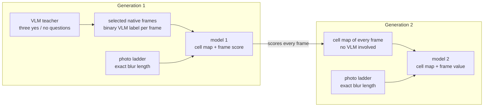

# The system: what each part is for, what it does, and how to set it

This document describes the whole system behind the Frame Blur Detection series: the dataset, the labels, the photo
anchors, the input, the detector, the training, the readouts and the evaluation. For each part it says what it was
used for, what it did, measured on the models of the series, and how to set it. It is meant to let someone build an
equivalent dataset and model from their own material.

**Where the numbers come from:**
- the published repositories:
  [original](https://github.com/mschauta/frame-blur-detection),
  [Update 1](https://github.com/mschauta/frame-blur-detection-update-1),
  [Update 2](https://github.com/mschauta/frame-blur-detection-update-2);
- their experiments: R4S-1, R4K-1 and R4K-2;
- the author's lab notebook, for the runs not published (marked *lab notebook*).

Each number names its model. The training data is private (copyrighted videos and photographs), so the numbers can be
checked against the published evidence but not recomputed from the data.

**Scope.** Everything below was measured on one kind of material: human-centred, handheld-camera video, H.264, 1080p,
4:2:0, with 173 videos. What carries over to other material is discussed in Section 17.

## 1. Definitions the system rests on

- **The question.** Is a whole frame usable, or is it blurred? A frame counts as one picture, not as a composition
  that is allowed to be partly soft.
- **The cost is asymmetric.** A blurred frame accepted as sharp is the expensive error. The main figure is therefore
  the share of sharp frames kept at a threshold strict enough to catch 95% or 98% of the blurred frames.
- **Sharp is defined by an etalon, not by a judge.** A published professional photograph with no added blur is 0 px,
  absolutely sharp. Every length of added blur is measured from it. Whether 1 px or 3 px still counts as sharp is a
  choice made when filtering, not a property of the picture.
- **Blur is positive evidence; sharp is its absence.** One clearly blurred region is enough to call a frame blurred.
  A model that has never learned a kind of blur will call it sharp, which is why a model's "sharp" is the less
  reliable verdict (Section 13).
- **Witnesses are not targets.** The VLM labels and the motion measurement check the detector. It is never tuned to
  resemble them: where they disagree, the question is who is right, not how to agree.

## 2. Generations: how the model changes, and whether the student can surpass its teacher

### 2.1 The scheme

Every model of the series belongs to one of two generations. Both combine native frames with the photo ladder, and
both end in a model that runs without the VLM, gives a cell map, and is thresholded when filtering. They differ in
where the frame targets come from.

- **Generation 1:**
  - **frames:** a selected set of native frames with a binary VLM label each (Update 1: 589,663 frames, chosen from
    the 1,019,201 labelled ones);
  - **photos:** the ladder;
  - **result:** model 1, which scores frames without the VLM and gives a cell map the VLM never had.
- **Generation 2:**
  - **frames:** every frame of the training videos (Update 2: 4,850,458), most of them never labelled. Each carries
    model 1's cell map as a soft target, and no VLM label is used;
  - **photos:** the ladder again;
  - **result:** model 2, with the same kind of output.

**The models of the series in this scheme:**

| | binary photo ladder | continuous photo ladder |
|---|---|---|
| Generation 1 (VLM labels) | Update 1, Base and Small (0–3 / 16–30 px) | Update 3 (0–30 px, GOP-coded), in training |
| Generation 2 (model 1's maps) | Update 2 (0–3 / 10–30 px, a stricter blurred side) | not yet run: it would learn Update 3's maps, if Update 3 passes |

### 2.2 What a generation inherits, and what it gets anew

| source | what it gives | in which generation |
|---|---|---|
| the teacher's frame targets | where the transition lies on native frames: the VLM's in Generation 1, model 1's in Generation 2 | inherited, in both |
| the teacher's consistent errors | for example the frame-type bias (Section 9.3) | inherited, unless an independent signal removes them |
| the photo ladder | the strictness at the ends, and from a continuous ladder the px scale | anew, in every generation, independent of any teacher |
| the data | coverage: Generation 2 learns from 8× as many frames, most of which model 1 had only scored | grows with each generation |
| the motion measurement | a veto where the teacher is probably wrong (Section 15) | in Generation 2 |
| the start | ImageNet weights, not the teacher's: the map is learned again, not copied | every generation |

**This is why the ladder must be present in every generation.** It is the only part of the target that no teacher
produced. When it changes, the student changes with it, whatever the teacher says. Update 2's blurred photos started
at 10 px instead of 16 px, and its decision on the photo ladder moved from about 9.1 px to about 6.9 px.

### 2.3 How the dependence on the VLM changes

- **Generation 1 learns the VLM's boundary but not its strictness.** The strictness comes from the etalon.
  - **The departure is measurable at the strict point** (Update 1 Base, partial corpus scoring, *lab notebook*). On
    the same fully scored videos, the VLM's sharp : blurred ratio is 1.6–3.4 : 1, the model's at r98 0.7–1.2 : 1.
  - **The disagreements are mostly one-sided:** most are "model blurred, VLM sharp", and on most of these the motion
    measurement sides with the model. The reverse occurs on about 1.4% of the labelled frames.
  - **It also gives what the VLM cannot:** a cell map that follows the motion (within-frame Spearman 0.34), at 65–87
    frames/s instead of about 0.5.
- **Generation 2 uses no VLM label, but the VLM's boundary lives on in model 1's maps.** The dependence is
  transformed, not removed:
  - **what disappears:** the VLM's frame-by-frame noise and its film-level offsets (which the film-relative `ssb`
    rule had to correct);
  - **what remains:** where the transition lies.
- **The threshold becomes VLM-independent step by step:**
  1. Generation 1, binary ladder: recall points on VLM-labelled validation frames. The scale is the model's, but the
     operating points are defined against the VLM.
  2. Generation 2: M > 0, "no cell says blur", is defined without the VLM. Its recall points are still read off
     VLM-labelled frames for comparison.
  3. A continuous ladder: a px threshold, defined on the etalon alone. That it means the same on native frames is the
     open condition (R4T-1 failed it; Update 3 tests it with the frame supervision kept).

### 2.4 Can the student surpass its teacher?

**How it can:**
- **An independent signal in its target:** the photo etalon, which sets strictness and scale regardless of the
  teacher.
- **Averaging:** on more and more varied data, the teacher's random errors average out. Self-training literature
  reports students better than their teachers: Xie et al., *Self-training with Noisy Student*, CVPR 2020;
  Furlanello et al., *Born-Again Neural Networks*, ICML 2018.
- **Richer targets:** a soft value per cell keeps the strength of the evidence. A pattern that co-occurs with the
  teacher's verdict (a local subject motion beside a global blur, for example) can be learned although the teacher
  did not rely on it.
- **A veto:** the measurement blocks the cells where the teacher is probably wrong.
- **A fresh start:** a new model from ImageNet re-learns the map instead of copying its weights.

**What limits it:**
- **Consistent errors are inherited.** Averaging does not remove an error the teacher makes every time, such as the
  frame-type bias. Only a signal the teacher did not produce removes it: GOP-coded photos, a codec-consistency test.
- **What the teacher never saw is extrapolation:** `sbb` and `bss` frames, overlays, and material outside the corpus.
- **Agreement with the teacher cannot show it.** A student that is better than its teacher looks worse when measured
  against that teacher. Surpassing can only be shown on witnesses the teacher did not produce (Section 16).

**The evidence so far.**

*Generation 1 against the VLM: partly surpassed.*

| | the VLM teacher | Update 1 |
|---|---|---|
| strictness | tolerant: `sss` can hide 3–5 px | set by the 0 px etalon; at r98 it rejects more, and the measurement mostly sides with it |
| where the blur is | not given | a cell map that follows the motion |
| speed | about 0.5 frames/s | 65–87 frames/s |
| close-ups | judged well (the measurement fails there) | stricter: 57.5% of the close-up sharp frames kept, against 79.3% of the others (validation films, at the threshold that lets at most 1% of the confident-blurred frames pass). Whether it is right is not known |
| deliberate background defocus | judges the composition: a sharp subject passes | a soft background raises the frame score |

It surpasses the VLM in strictness, localisation and speed, not in judging a composition.

*Generation 2 against Generation 1: not surpassed.*

| witness | Update 1 | Update 2 | reading |
|---|---|---|---|
| VLM labels, six held-out films, AUC | 0.963 | 0.959 | slightly lower; the VLM label is Update 1's kind of target |
| Spearman with the measured motion | 0.691 | 0.685 | equal |
| photo ladder, 50% flip | 9.1 px | 6.9 px | stricter, from the ladder change, not from the maps |
| order inside 0–3 px on photos | 0.617 (frame score) | 0.824 (mean inner cell logit, exploratory); M ties | the map holds more order, on photos |
| R4K-1: the shot-start I-frame scored sharper than the next two frames | 93.4% | 86.2% | inherited, weaker |
| R4K-1: the sharpest frame per 20 s window is an I-frame, × the expected share | 76× / 32× | 41× / 1.7× | smaller, mostly through M = 0 ties |
| frames with M = 0 | 17.8% (its own M) | 29.1% | more ties |

Update 2 changed where its etalon changed. It inherited the frame-type bias in a weaker form. On the independent
witnesses it did not improve on its teacher, so its distillation did not yet surpass the teacher.

**What would show a student surpassing its teacher next time.** It would have to improve on independent witnesses
while not losing more than a fixed margin on the VLM labels:
- a higher Spearman with the measured motion, at frame and cell level;
- more consistent scores across the same frames in AVC, HEVC and AV1, and across two releases of a film;
- a better order inside 0–3 px on the photo ladder;
- no I-frame preference when ranking.

### 2.5 The next step in this scheme

- **Generation 1 with a continuous ladder (Update 3)** is in training. Its protocol decides whether it reduces the
  frame-type bias without losing frame accuracy, and whether its px scale holds on native frames.
- **If it passes, it becomes the teacher of a Generation 2 with a continuous ladder.** Its cell maps, and possibly its
  px, over the whole corpus; the continuous GOP-coded ladder; the measurement veto; a fresh ImageNet start.
- **The conditions for any further generation** are in Section 15: new material, the same six held-out films never
  trained on, the photo anchors kept, and a stop when a generation does not improve on the witnesses.

## 3. Binary, length or blur mass: what each kind of output can say

### 3.1 Is blur a class at all?

- **Physically, blur has at least three dimensions, each continuous:**
  - **strength:** how far an edge is smeared;
  - **extent:** where in the picture, and how much of it;
  - **type:** camera motion, subject motion, defocus.
- **"Sharp" is a cut on that continuum,** and where it lies depends on the use.
  - **Shot size:** in the inspected ladders some extreme close-ups still looked usable at about 8 px, while fine detail
    in long shots changed at 2 px.
  - **Viewing and composition:** a deliberately soft background, for example.
- **A binary label is therefore a decision, not a property of the picture.** It is valid only with a declared cut,
  and every binary labelling of a continuum has an error band around its cut. The band is as wide as the judge's
  tolerance: the VLM keeps `sss` on some photos up to 3–5 px, and its answers start to change between 4 and 6 px.
- **So blur can be classified binarily only for a stated purpose:** "is this whole frame usable for this use". The
  band around the cut has to be left out of training or declared uncertain.

### 3.2 The binary approach (the original models, Update 1)

**How it was made separable:** the band was removed on both sides.
- **Photos:** 4–15 px were never trained.
- **Frames:** the contradictory codes (`ssb` in `sss`-dominant films, `sbb`, `bss`) were left out, and the in-shot
  measurement dropped the sharp frames most likely to be blurred.

**What it gives:**
- **The most accurate decision against the VLM labels so far:** held-out AUC 0.963 (Update 1 Base).
- **Clear cases separated almost perfectly:** confident AUC 0.995.
- **Outputs saturated at both ends:** a logit of about −22 from 0 to 6 px, then a jump between 8 and 10 px.

**Its limits:**
- **Nobody chose the cut on the physical scale.** It falls where the training gap lets it fall: about 9 px on the
  photo ladder. On frames the cut is the VLM's.
  - Without a gap on the sharp side the band reads as sharp. In round 1d (sharp = only the original photo), only
    6.5–14% of the `sss` frames were called blurred at p > 0.5.
- **No order inside a class.** The 0–3 px pair order is 0.62 (Base) and 0.66 (Small), so the sharpest frame of a time
  window cannot be picked.
- **The score is a certainty, not a degree.** A frame with one small blurred spot and a frame blurred all over can get
  the same score.
- **The strict operating points lie where the score is compressed.** The r98 threshold is 0.0164 on a sigmoid. These
  points hang on the few sharpest-looking blurred frames, and the calibration never settles.
- **Moving the cut** means a new recall point on a saturated score, or a new training run.

### 3.3 The length approach (R4T-1, Update 3)

**What it gives:**
- **A physical unit:** px of uniform camera motion, defined on the etalon. The cut becomes a number chosen when
  filtering, not something learned.
- **Order inside the sharp range:** on photos the 0–3 px pair order is 0.945, with a resolution of about 1 px (R4T-1).
- **A real measurement where the blur is the trained kind:** on pure camera-motion frames, Spearman 0.76–0.79 with the
  measured camera motion.

**Its limits:**
- **The px of a native frame is photo-equivalent:** the uniform camera blur that would give the same response.
  - Defocus has no length, and subject motion is local.
  - The frame's own softness (optics, sensor, downscaling, compression) is included, because a frame has no 0 px
    point.
  - The value can be witnessed on frames but never checked.
- **One number per frame averages local blur away.** The photo-only model measured 17–29% of the `bbb` frames under
  1 px.
- **Learned from photos alone, it does not transfer:** the scale fails on frames, and the map does not find the
  motion (R4T-1). It needs frame supervision beside it, which is Update 3's design.
- **It is blind where there is no texture.** 54% of the photo cells are homogeneous, and blur barely changes their
  residual.
- **It is bounded** by the ladder (0–30 px) and by the coding chain it was taught through.

### 3.4 The blur mass M (Update 2)

**What it is:** not a length and not a class, but an extent with a confidence: the mean of the positive cell logits
over the inner cells.

**What it gives:**
- **A natural zero that no teacher set.** M = 0 means that no cell says blur. It is the strictest criterion: 49.1% of
  the sharp frames kept and 97.8% of the blurred caught (test films).
- **A fixed readout that cannot drift.** The learned LSE sharpness r drifted from 4.1 to 0.86 in Update 1.
- **Area weighting:** a soft background counts in proportion to its size, and a sharp background cannot average a
  blurred spot away.
- **AUC 0.959** against the VLM labels.

**Its limits:**
- **Ties:** 29% of the held-out frames have M = 0, and M cannot rank them.
- **Saturation above the flip:** M is about 20 from 8 px on. It says how much of the picture shows blur and how
  surely, not how long the blur is.
- **A small region counts little:** area weighting tolerates a small, strongly blurred region, such as a fast-moving
  hand.
- **It inherits the calibration** of the map it reads.
- **Its thresholds belong to the readout** (inner cells or all cells).

### 3.5 Side by side

| | binary | length (px) | blur mass M |
|---|---|---|---|
| answers | usable by the teacher's cut? | how long is the blur, photo-equivalent? | how much of the frame shows blur, how surely? |
| the cut | learned: the teacher's on frames, the gap's on photos | chosen at filtering, in px | chosen at filtering; M = 0 is a natural zero |
| order inside the sharp range | no (0.62–0.66) | on photos yes (0.945); on frames not shown | no (ties); the map's mean cell logit orders 82% of photo pairs |
| clear cases (confident frames) | 0.995 (Update 1) | 0.931 (photo-only, R4T-1) | not measured |
| against the VLM labels, held-out | 0.963 | photo-only: weak | 0.959 |
| a small local blur | a soft maximum: blurred if it appears anywhere | averaged into one number | in proportion to its area |
| typical failure | no degree; the cut cannot move | photo-only: no transfer, no location | ties; a small blurred region tolerated |

### 3.6 Which is best, and which separates most cleanly

- **The clear cases do not decide it.** Every frame-trained output separates clear blur from clear sharpness almost
  perfectly. What limits all of them on frames is the label band around the cut, not the type of output.
- **At a cut set by a teacher, the binary output separates most cleanly,** because it was trained on that cut. Against
  the VLM labels, Update 1 is the best tool so far.
- **At a physically defined cut, only the length separates by construction:** any px threshold, at any time, without
  retraining. This holds on photos; on frames it is the open condition.
- **For "no blur anywhere", M = 0 is the cleanest criterion.** It is the only zero that no teacher set.
- **None of them describes a frame alone.** A single number projects strength, extent and certainty onto one axis, and
  each projection loses one of them:
  - the binary score loses the degree;
  - the length loses the location;
  - M loses the length.

**The approach that follows from this.** Update 3 starts this design; it is not yet validated.
1. **Measure per cell, in px:** frame supervision says where, photo supervision says how much.
2. **Derive the frame readouts from that map:**
   - the worst cell's length, for strictness;
   - the share of the frame above a given length, a generalised M, for tolerance (for example "at most 3% of the
     cells above 3 px", the case of an intruding hand);
   - a robust frame length, for ranking (Phase II).
3. **Decide when filtering:** a binary rule per task, with an uncertain band where needed. The blurred verdict is the
   more reliable one, so the blurred side can be bold and the sharp side strict (Section 13).

**Until the px map holds on native frames:**
- use binary Update 1 for decisions;
- use M = 0 for the strictest filter;
- use the map for where the blur is;
- nothing yet ranks frames inside the sharp range.

## 4. The parts at a glance

| part | what it is | used for | not used for |
|---|---|---|---|
| native frames | every frame of the videos, decoded and stored losslessly | the material to judge; the frame side of training | — |
| VLM labels | a frozen vision-language model's answers to three yes / no questions | the frame class in training; a witness | ground truth; a quality metric |
| motion measurement | a non-learned estimate of camera and regional motion between neighbouring frames | ranking inside a shot during selection; a witness; a veto against teacher errors | a label; a model input |
| photo ladder | professional photos with a known amount of added camera blur, through the video coding path | the exact scale; the dense cell target; the regulariser of training | the task by itself |
| edge fingerprint | the signed high-pass residual of a fixed mesh reconstruction, normalised per image | the only image input of the detector | — |
| detector | a ConvNeXt trunk with one logit per 16 px cell and a frame readout | scoring every frame, with a cell map | — |
| readout and threshold | how the cell logits become a frame decision | the filter | — |
| distillation | the detector's own outputs as targets over the whole corpus | coverage, spatial targets, speed | proof of accuracy |
| witnesses | held-out films, confident frames, motion, photo ladder, two releases, codec tests | evaluation | training |

## 5. The dataset: native frames

**Extraction.**
- Every frame is decoded at the video's own frame rate and stored losslessly as PNG.
- The stored frame is exactly the decoded picture: the source's coding artefacts belong to it, and nothing is added.
- The pipeline has no JPEG step, which is why JPEG robustness is not a goal (Section 9.3).
- Frames with burnt-in subtitles or overlay text are excluded.
- A content filter keeps frames with luminance standard deviation ≥ 1, entropy ≥ 1 bit, and at most 90% over- or
  under-exposed pixels.

**Units:**
- **Shots:** runs of near-identical framing, cut by a simple frame similarity (a 16 × 9 colour grid, a trimmed
  distance), at least 0.5 s long. A shot is the unit inside which frames can be compared.
- **Films:** two releases of the same film at different bitrates are one film (31 films found by matching cut times).
  They always share a split, and they give a free consistency test: the same picture at two bitrates.
- **Split:** by film, chosen by hand. The 3 validation and 3 test films (160,142 frames) were never trained on in any
  update, nor was any release of them.

**Watermarks.** Every frame of the corpus carries a semi-transparent watermark at a fixed position per video. A
per-video validity mask (SAM3-assisted) marks it. Section 9.6 explains how the training treats it.

**What is unknown, and stays unknown:**
- **The blur length.** The exposure time is not known. The motion measurement gives the displacement between
  neighbouring frames, not the length of the smear. On pure camera-motion frames the measured blur was about 0.30–0.33
  of the inter-frame motion, which is about 1/100 s at 30 fps. It varied from 0.07 to 0.65 between films (R4T-1, *lab
  notebook*).
- **The blur map.** No frame says where it is blurred. There is no pixel or cell truth on frames. Cell targets on
  frames can only come from a model (Section 15).

**Scale used here:** 173 videos (H.264, 1920 × 1080, 4:2:0) and 5,010,602 frames. A VLM label exists for 1,019,201
of them.

**What the dataset is for.** The native frames are the asset. Everything else (labels, photos, models) exists to
judge them, and a method that works only on synthetic material does not count.

## 6. The teacher: VLM labels

**The model.** A frozen Qwen3.5-4B (bf16). Its code and weights are identified by hash, and three control images are
replayed before every labelling session.
- Three questions per frame:
  1. a "blurry" question, sensitive to motion blur;
  2. "Is this video frame sharp?";
  3. "Is this image sharp?", which is much stricter for one word of difference.
- Answers are forced to a bare yes / no, in batches of 4 with greedy decoding. This is deterministic: on a re-run,
  3,517 of 3,517 codes were bit-identical.
- A code such as `sss` or `bsb` records the three answers.

**Why this size** (*lab notebook*):
- **0.8B** answered "no" to everything (`sbb`), and **2B** answered "yes" to everything (`bss`). Neither discriminates.
- **9B** was more lenient: it called 91% of the original photos `sss` (4B: 76.5%), and it called sharp 15.9% of the
  frames that 4B called blurred. It was also 25% slower.
- **4B** was the one that worked.

**Classes:**
- **sharp:** `sss`. In films where `sss / (sss + ssb) < 0.46`, `ssb` counts as sharp too. There `ssb` measures as
  sharp as `sss` does elsewhere: the label has a film-level offset, and this rule removes it.
- **blurred:** `bbb` and `bsb`.
- **left out:** `sbb`, `bss` and the rest are contradictory or borderline codes.

**What the labels are like:**
- **Tolerant.** On photos with known blur, the "video frame sharp" question starts to change from about 4 px, and
  the "blurry" question from about 6 px (original METHOD §6.1). A `sss` frame can therefore hide 3–5 px of blur (*lab
  notebook*).
- **Noisy at the boundary.** The VLM judges the composition, and the detector learns the pattern. Their agreement is
  capped by the VLM's borderline cases.
- **Neutral to the coded frame type.** A keyframe's label is barely sharper than its neighbours': 7.1% against
  6.0% ([pre-check](experiments/u3_precheck_frametype/)).
- **Slow.** About 40,000 frames per day (about 0.5 frames/s), against 65–87 frames/s for a detector on the same GPU.

**Role.** Supervision for the decision boundary, and a reference. The decision is not distilled from the VLM
as such: the photo etalon sets the strictness, and the VLM sets where the transition lies on frames.

## 7. The witness: the motion measurement

**What it measures.** The camera motion (the median over 256 px tiles) and the regional motion (residual displacement
after camera compensation, in 160 px cells). The value comes from three frame pairs around a frame, and the smallest
reading wins, to survive motion reversals. Alongside it there is a sharpness rank inside the shot.
- These are displacement proxies, not blur lengths.
- Only structured pixels vote, and the watermark does not.
- A 160 px motion grid is stored for every frame.

**What it is used for:**
- **Selection:** it ranks frames inside a shot, never on an absolute scale. Close-ups move many pixels and still
  keep their order.
- **Witness:** for example, how well a detector's score follows the measured motion (Spearman).
- **Veto:** in Update 2, a block with strong measured motion but a sharp teacher map was not taught.

**Never used as** a label or a model input. That keeps it independent. A detector that agrees with it (Update 1:
Spearman 0.71 with regional motion) learned the motion from the pictures, not from the measurement.

**Why not use it alone.** Measured motion is not exposure blur. Thresholds that worked on long shots failed on
close-ups, and shot size could not be determined reliably. It ranks well inside a shot but has no absolute
boundary.

## 8. Frame selection (the v8 rules)

| rule | what it does | why |
|---|---|---|
| films as units, both releases in the same split | no leakage across bitrates | the same picture must not be in train and validation |
| sharp = `sss` (+ film-relative `ssb`), blurred = `bbb` + `bsb` | clean classes | contradictory codes are noise |
| per shot, the sharp frames lose their largest 20% by measured motion, and each blurred code loses its smallest 10% | removes the frames most likely mislabelled | the measurement only ranks inside a shot |
| at least one frame per shot and class stays | every shot contributes | scene variety |
| no thinning: every remaining labelled frame is a sample, neighbours included | many similar frames instead of a few repeated | Section 12.1 |
| validation and test 1 : 1 per film | balanced evaluation | — |

Result for Update 1: 589,663 training frames (349,624 sharp, 240,039 blurred).

**Lessons from the early rounds** (*lab notebook*):
- **Videos that give only blurred frames teach the video, not the blur.** In the first round, with such videos, the
  AUC was about 0.5.
- **Frames only on the blurred side teach "frame = blur".** In round 1e the validity-mask channel alone revealed a
  frame. Both classes must come from frames.
- **Photos form one pool, with no stratum per source.** The pattern is taught, not the source.
- **No per-video weighting.** The selection decides which frames take part, and the sampler does not re-weight them.

## 9. The etalon and regulariser: the photo ladder

### 9.1 The originals

- **Material:** 48,797 originals, the same pool in every update, split before any variant is made:
  - camera-EXIF photos, split by shoot group;
  - photos from published professional albums, split by album;
  - 231 hand-reviewed 4K video frames, split by album.

  The split is 33,484 train, 7,656 validation and 7,657 test originals.
- **Why professional photos:** they are the etalon. They are sharpened and downscaled, so a 0 px photo can be sharper
  than any real frame. This is intended: frames are measured against the etalon, which makes sharpness absolute and
  source-independent.
- **Selection:** EXIF is preferred, because exposure time, focal length and aperture expose suspicious photos, but a
  published professional album qualifies without it. The 4K video frames are not an etalon (keep them for testing
  only).
- **What L = 0 means:** no added blur. It is a sharp composition, which can include deliberate background defocus. It
  is not a claim that every region is in focus.

### 9.2 The synthetic blur

- **Uniform straight camera motion of length L,** in 12 directions (every 15°) or any angle, applied in linear light.
- **Kernel v2:** the motion segment is convolved with the tent (linear-interpolation) reconstruction of the image,
  with 64 sub-samples per pixel. This makes small L correct: 1 px already blurs.
  - The first kernel, v1, was the identity at 1 px and underestimated small lengths. It was replaced.
- **Continuous, not frame averaging.** Datasets that average high-speed frames (GoPro) produce a comb of discrete
  edge copies: 7 copies about 6.3 px apart on one inspected pair. That is not native blur, and a fingerprint model
  can mistake it for a sharp pattern. Such data serves as a test, not as training material (original README).

### 9.3 The coding chain: what it simulates

A photo reaches the model only after the same kind of coding a frame went through. The signed edge fingerprint
(Section 10) is a high-pass residual, so it shows everything the coding does at the finest scale. Each step of the chain
exists to make one coding property the same on photos and frames, so that the model cannot use it as a shortcut.

1. **The noise floor.**
   - **The problem:** an uncoded photo carries sensor grain. Synthetic blur stretches that grain into fine streaks
     along the motion direction, a pattern native frames never show.
   - **What fixes it:** H.264 suppresses it.
   - **The measure:** an exploratory probe compared photos and sharp frames on flat-region residual statistics. It
     ranked H.264 CRF 23 closest to the frames, JPEG not (original METHOD §6).
2. **Block and quantisation structure.**
   - **What coding adds:** transform blocks and quantisation, which appear in the fingerprint as 8 px block edges and
     as flattened areas. The probe's criterion includes an 8 px block statistic.
   - **Why it must be on both sides:** coded photos carry the structure in both classes, so the model learns that
     block edges are neither sharpness nor blur.
   - **Uncoded input, measured:** without the coding, 18.7% of the sharp photos produce a cell at or above 0 in Update
     1, against none with it. The models rely on the chain they were trained on.
   - **JPEG:** for the fingerprint model, the sharp photos kept fell from 85% to 56% as JPEG grew stronger (original
     cross-test, *lab notebook*). The JPEG grid probably reads as edges; this was not measured. JPEG is outside the
     task, because frames are PNG.
3. **Intra against inter coding: the frame type.**
   - **The problem:** a photo coded alone is an I-frame, while most video frames are P- or B-frames. Until Update 3
     every sharp anchor was an I-frame, and every model learned that sharp looks like an I-frame:
     - **R4K-1** (two videos, observational): inside a shot, Update 1 scores the I-frame sharper than its neighbours
       in 93% of comparisons on one video. Picking the sharpest frame per 20 s window selects an I-frame 32–76× more
       often than the I-frame share predicts.
     - **R4K-2** (sharp photos, controlled): the same sharp source frame coded as P/B scores 7–14 logits blurrier
       under Update 1 (at CRF 23 and 2 Mbit/s, and in the panning clips). With I-frames only, false alarms are
       0.0–0.2%. Over all 115,200 test frames, Update 1 Small calls 2.4% blurred and the Base 1.7% (r95).
     - **The labels do not cause it** (Section 6). The coding path does.
   - **Update 3's fix:** the photo goes through an 8-frame clip (x264 / x265 / AV1; I-only, IP or IPB; whole-pixel
     pans; film grain on part of the AV1 samples), and the sample is one decoded frame of it. About 70% of the photo
     samples are inter frames.
4. **The rest of the chain:** BT.709, TV range, 4:2:0, as in the frames. The CRF varies:
   - Update 1 and Update 2: 20 / 23 / 26 / 28.
   - Update 3: per-codec lists matched to about 35–41 dB PSNR.

**The rule behind it:** degrade the etalon only to the level of good video, so that good frames can pass. Bad
quality is filtered out, never taught as acceptable.

### 9.4 Lengths and classes

| | sharp | blurred | between | result |
|---|---|---|---|---|
| original, Update 1 | 0, 1, 2, 3 px | 16, 20, 24, 30 px | 4–15 px not trained | easy separation; the decision flips at about 9 px on the photo ladder; no order inside 0–3 px (pair order 0.62 Base, 0.66 Small) |
| Update 2 | 0–3 px | 10, 12, 16, 20, 24, 30 px | 4–9 px not trained | the flip moves to about 6.9 px, inside the gap |
| R4T-1 (photos only) | continuous 0–30 px, as a length | | — | orders 0–3 px on photos (0.945); fails on frames (Section 14) |
| Update 3 | continuous 0–30 px, as a length | | — | in training |

**Why the gap at first.** The 0–3 px tolerance was set with the VLM: up to 3 px it answers on blurred photos as
on the original. The 16 px start of the blurred side was a visual choice. Without an intermediate band, the photos
agree with the binary frame labels, and the transition on frames is taught by the frames.

**The cost of the gap.** The model is never told what 4–15 px looks like, and it does not rank inside the sharp
range. A frame score saturates at both ends.

**Why a continuous ladder now.** Phase II (the sharpest frame per time window) needs an order inside the sharp
range. The ladder then defines a px scale, and the class is chosen at filtering time.

### 9.5 Targets on photos

- **Image level:** the class (Update 1, Update 2) or the ordinal length targets (R4T-1, Update 3).
- **Cell level (the dense term, weight 0.5):** every cell that has structure on the original photo gets the photo's
  target, because the injected blur is global.
  - Whether a cell is structured is decided on the original, not on the blurred photo. Deciding it on the blurred
    photo would drop most cells of a strongly blurred photo: at 20 px only about 5% would keep a target.
  - The threshold is a mean |d| of at least 0.001.
- **Smooth cells carry no visible blur.** On 40 photos, 54% of the cells were homogeneous and kept 87–100% of their
  edge energy even at 20 px (*lab notebook*). Untextured surfaces are the visibility limit of any local detector.
- **The outer cell ring** was left untaught in Update 2.

### 9.6 Watermark masks

- **Update 1:** half of the photo samples and half of the frame samples carry a watermark validity mask taken from
  the frames.
  - On masked photos the mask does not mark a photo.
  - On unmasked frames the visible watermark teaches that a sharp overlay does not make a blurred frame sharp.
- **The leak:** next to a mask, valid pixels were computed from masked neighbours, and those pixels entered the p99
  scale.
  - Update 1 Small fixed it: masked pixels take the nearest valid colour, and the scale counts only pixels whose
    3 × 3 neighbourhood holds no masked pixel.
  - Update 2 kept the leak on its masked photo half.
- **Update 3** uses no masks, as the scoring tools use none.
- **The consequence of either choice:** the model is blind to overlays by design. Captions, graphics and animation
  are out of scope.

### 9.7 Presence, ratio and mosaic

**Always present.** Photos are in every epoch from the first step to the last, beside the frames. They are the
only exact signal, so they anchor the scale while the noisy frame labels pull the decision.

**The photo term saturates early:**
- On the first runs the photo validation AUC was 1.000 from epoch 5.
- In Update 2 the photo term was almost always met by about epoch 10: median loss 0.00017 against 0.071 for
  frames.

From then on the photos hold the ends of the scale and stop the frame side from drifting there. The frames teach the
rest.

**The ratio:**

| | photo samples per epoch | frame samples per epoch | ratio |
|---|---|---|---|
| original, Update 1, Update 3 | 6,000 / 24,000 / 24,000 | 6,000 / 24,000 / 24,000 | 1 : 1 |
| Update 2 | 80,841 | 242,523 | 1 : 3 |

The ratio's own effect has not been isolated: Update 2 changed it together with the frame targets and the ladder.
Two observations bound it:
- **The photos define what sharp texture looks like.** Wrong photos, such as I-frame-only anchors, made every model
  codec-dependent at any ratio.
- **Photos alone do not make a frame detector (R4T-1).** A large photo share can cost frame accuracy.

**Mosaic** (R4T-1): blocks of different known lengths inside one photo, on the cell grid. Against the plain ladder
it kept the transfer to frames at image level: confident AUC 0.931 against 0.862 after 10 epochs. It did not teach
the cell map where motion is: the within-frame Spearman with the measured subject motion was 0.007, against 0.34 for
Update 1.

## 10. The input: the signed edge fingerprint

**Definition:**
- `d = Y − K * Y`, where Y is the linear-light luminance (Rec. 709) and K = [3 10 3; 10 92 10; 3 10 3] / 144. K is
  the area integral of the uncalibrated `m09` biquadratic mesh of
  [RGB Mesh Resampling](https://github.com/mschauta/rgb-mesh-resampling).
- d is the part of the image that the mesh reconstruction does not keep. It is a fixed, weighted discrete Laplacian.
- Normalisation: divided by the 99.5th percentile of |d| over the valid pixels (floor 10⁻³), then companded as
  `sign · √|·|`.
- A second channel carries the validity mask.

**What it shows:**
- **Sign:** it is negative on the darker side of an edge and positive on the brighter side, so a line keeps its
  polarity.
- **Blur:** the edges thicken first. A clean displacement doubles the contours, and motion blur makes parallel bands
  along its direction.
- **Everything else at the finest scale:** texture, noise and coding artefacts. Hence Section 9.3.

**Precision.**
- **Up to the original runs:** the convolution ran inside bf16 autocast. The error was of the order of the signal
  (median 7·10⁻⁵ against a median |d| of 2·10⁻⁴), and a flat image gave inputs up to ±0.74.
- **From Update 1 on:** computed in float32, outside autocast.

Compute the fingerprint exactly as at training: a model trained on the rounded input expects the rounding.

**Against RGB and grayscale** (original study, ConvNeXt-Small, 100 epochs, the same recipe):

| input | validation AUC | sharp kept at 95% / 98% | confident AUC | GoPro native: sharp kept / blurred caught |
|---|---|---|---|---|
| RGB | 0.952 | 74.9% / 61.7% | 0.992 | 64.2% / 96.7% |
| grayscale | 0.942 | 70.0% / 52.1% | 0.993 | 66.8% / 98.0% |
| fingerprint | 0.949 | 73.9% / 58.2% | 0.990 | 97.3% / 73.3% |

- **All three inputs carry enough information.** RGB learns faster and ends 2–5 points ahead at the strict points.
  On the confident frames the order reverses, so part of RGB's lead is agreement with a teacher that also sees RGB.
- **The fingerprint depends less on the general look of an image:**
  - on native GoPro images (their own noise and ISP) it keeps 97% of the sharp ones, while the image models fall
    to 64–67%;
  - on uncoded photos it keeps 85% of the sharp ones, against 68% for RGB and 56% for grayscale (*lab notebook*).

  Its cost is that a pattern imitating sharp edges fools it more: it catches 73% of GoPro's comb blur, against 97%
  for RGB.
- **Little transfer between the fingerprint and the image** (cross-test): the models adapt to their own
  representation. RGB and grayscale transfer to each other, so colour is not needed.

**Why the series kept the fingerprint:**
- it reaches the image models' level;
- it learns from the blur-bearing layer only;
- it is less tied to the look of the source.

**An untested risk: dark regions.** Linear light makes dark values small, so dark areas have a residual near 0
relative to the image's p99 scale, which looks blur-like. Poorly lit frames were marked blurred on film material. A
test on synthetically darkened 0 px photos would separate the input effect from real blur.

## 11. The detector

**Trunk:** the original ConvNeXt (torchvision implementation, not ConvNeXt V2), up to stride 16.
- **Adapted first layer:** the fingerprint channel starts from the sum of the pretrained RGB filters, the mask channel
  from 0.
- **Head:** 1×1 conv to 128, GELU, 1×1 to 1, so one logit per 16 px cell.
- **Excluded cells:** a cell covered less than half by valid pixels.

**Initialisation:**

| start | result |
|---|---|
| ImageNet-1K (torchvision, supervised) | used by every published model. Update 1 Base: validation AUC 0.869 after one epoch, 0.921 after two |
| DINOv3 (self-supervised), same recipe and learning rate | behind ImageNet at every stage; about 3× larger epoch-to-epoch AUC swings with smaller weight changes; AUC 0.936 after 60 epochs (*lab notebook*) |
| random (Base) | AUC 0.65–0.66 after three epochs; stopped (*lab notebook*) |

Every new model starts from ImageNet, not from its predecessor's weights, so that a map is learned again rather than
inherited (Update 2, Update 3).

**Size: ConvNeXt-Small against ConvNeXt-Base** (R4S-1: the same recipe, the published epoch 29, the six held-out
films):

| | Small | Base |
|---|---|---|
| parameters / weight file | 34.0 M / 130 MB | 60.2 M / 230 MB |
| training, 30 epochs (wall clock) | 22.6 h | 28.5 h |
| inference, one 1080p frame, RTX 5090 | 11.5 ms (87 frames/s) | 15.4 ms (65 frames/s) |
| held-out AUC | 0.962 | 0.963; difference −0.0007 [−0.0018, +0.0004], none shown |
| sharp kept at r95 / r98 | 79.0% / 65.8% | 80.4% / 67.9% |
| Spearman with the measured motion | 0.705 | 0.699 (difference +0.006 [+0.001, +0.011]) |
| photo ladder: flip / 0–3 px pair order | 9.04 px / 65.9% | 9.13 px / 61.7% |
| R4K-2 sharp photos (all 115,200 frames) called blurred at r95 | 2.4% | 1.7% |

- **For the Small:** it is 1.35× faster, about half the size and trains in 20% less time. Its AUC is the same, it
  agrees slightly more with the motion, and it orders 0–3 px slightly better.
- **For the Base:** it keeps 1.4–2.1 points more sharp frames at the strict points, has a wider logit range, and gives
  fewer codec false alarms.
- **The choice:** where speed matters (a whole corpus, a desktop tool), the Small. Where the strictest operating point
  matters, the Base.
- **The caveat:** the comparison is not pure. The Small also had the mask-leak fix.

**The frame readout:**

| readout | definition | behaviour |
|---|---|---|
| LSE (original, Update 1, Update 3) | masked log-sum-exp of the cell logits with a learnable sharpness r: a soft maximum | "blurred if blur appears anywhere", but r is learned: in Update 1 it fell from 4.1 to 0.86, towards an average. A dominant cell gives about `local − log(n) / r`, so the size of the region counts |
| blur mass M (Update 2) | the mean of max(0, cell logit) over the inner cells, fixed | it cannot drift. M = 0 means no cell says blur, and only blur cells count, so a sharp background cannot average a blurred spot away. It ties many frames at 0 (29% of the held-out frames) |
| ordinal (R4T-1, Update 3) | logit(L ≥ t_k) = s − b_k on 15–16 thresholds; length L̂ = Σ σ(s − b_k)(t_k − t_{k−1}) | gives px. Anchored at 1 px (R4T-1) or floating, with the frames' VLM boundary at s = 0 (Update 3) |

**Known failure modes of any readout:**
- **Deliberate background defocus:** a soft background raises a sharp subject's frame score. A cell map with a subject
  mask, or a crop that is re-scored, handles it.
- **A small, dark, low-contrast moving region:** it is missed.
- **Untextured surfaces:** blur there is invisible (Section 9.5).

## 12. Training

### 12.1 Repetition: every sample new, or the same sample again

**The principle** (the author's): the model should see many similar samples, each about once, rather than the same
samples repeatedly.
- Neighbouring frames of a shot are near-permutations of one picture, as the grid variants of a photo are. Learning
  from them is continuous and dynamic.
- Labelled frames are therefore never thinned, de-duplicated or capped (Section 8).
- Photos are never repeated: each draw is a new variant.

**How often each run actually saw a sample:**

| run | samples | frames: passes | photos: draws per original |
|---|---|---|---|
| original, 100 epochs × 12,000 | 1.2 M | sharp about 23 passes, blurred about 5 | about 18 (9 passes per class), each a different point of a 192-point grid (length × 12 directions × 4 CRF) |
| Update 1, 30 epochs × 48,000 | 1.44 M | sharp 1.03 passes (349,624 frames), blurred 1.5 (240,039) | about 21, each a different grid point |
| Update 2, 20 epochs | 4.85 M frames + 1.62 M photos | exactly one pass (each frame once) | about 48, each a different grid point |
| Update 3, 30 epochs × 48,000 | 1.44 M | as Update 1 | about 21, each a new continuous recipe (length, direction, codec, structure, CRF, pan, frame) |

**What repetition did:**
- **The original runs repeated their frames many times.** On their own training frames they kept improving to the end
  (AUC 0.992–0.997, 91–94% of the sharp kept at 95%). On unseen videos the curves flattened after the third pass over
  the blurred frames, and the gap grew to 19–20 points.
- **Update 1 saw each frame about once.** The gap between a fixed subset of the training films and the validation films
  stayed at 4–10 points at r95 after the first epoch, and was about 7 at the end. That subset measures known films, not learned frames: most of its frames are
  drawn later or never.
- **No memorisation of frames.** Update 1 Small scored the training frames already drawn and those not yet drawn at the
  same AUC (epoch 18: 0.9785 against 0.9792). The remaining validation gap is between films, not between seen and
  unseen frames.

**In practice:**
- Prefer more labelled frames, each seen about once, to more epochs over fewer frames.
- Let the photos supply a fresh variant on every draw.
- Track "seen against not yet seen" AUC on a fixed training subset: if the two part, the model is memorising.

### 12.2 Learning rate, schedule and noise

**Settings shared by every run of the series:**
- **Optimiser:** AdamW, learning rate 1e-4 for the trunk and 1e-3 for the head, weight decay 0.05.
- **Gradients:** clipping at 1.0; batch 8 × 2 accumulation (effective 16), bucketed by image shape.
- **Augmentation:** quarter turns and flips, exact on the cell grid.
- **Arithmetic:** bf16 autocast for the trunk.

**Schedule:**

| run | schedule |
|---|---|
| original | 0.5-epoch warm-up, one cosine to 1% over 100 epochs |
| Update 1, Update 3 | 0.25-epoch warm-up, one cosine to 1% over 30 epochs |
| Update 2 | warm-up, stable, decay: 0.25-epoch warm-up, a constant rate, cosine to 1% over the last 20% of the steps; EMA of the weights (decay 0.9998), evaluated and published |

**The validation curve is noisy, and the noise has causes:**
- **The data cycles:** the strata are revisited at different rates, and the original runs' curves oscillated with
  these cycles.
- **The strict operating points hang on a few frames:** the 98% point depends on the sharpest-looking blurred frames,
  about 66 frames in the original validation set.
- **Single scenes change verdict between neighbouring epochs:** in one scene a model called 17 of 17 frames blurred at
  epoch 13 and 1 of 17 at epoch 30 (*lab notebook*).
- **Single-epoch dips:**
  - Update 1 Small: 0.9338 → 0.9070 → 0.9373 at epochs 4–6.
  - Update 3: 0.9272 → 0.9101 at epochs 1–2.
- **GPU non-determinism and one seed per run:** the spread between seeds is unknown.

Compare runs by means over passes or by the fixed last epoch, never by single epochs.

**What the decay at the end does:**
- **Update 1 Base:**
  - it improved steadily to epoch 15, then held a plateau from epoch 15 to 20 (AUC 0.950–0.957);
  - its calibration loss (NLL) worsened at epochs 19–20 (0.310 → 0.378);
  - with the learning rate at about 0.15 of its peak it reached new highs at epochs 21–22 (0.9587), and it ended at
    0.9621 at epoch 29.

  The plateau was a long swing, not saturation.
- **Update 2:** most of the last gain came in the decay. The fit to the targets improved by 17.5% in epochs 16–19,
  against 12% in the ten constant epochs 5–15. The gap between held-out and training frames narrowed during the decay:
  lowering the noise did not cost generalisation.
- **The over-confidence remains:** the NLL stays above its best while the ordering improves. Calibrate the
  temperature if probabilities are needed.

**Warm-up, stable, decay** suits the "every frame once" principle better than one long cosine. The constant phase
can be extended when new data arrives, and the gain comes in the short decay. Update 2 used it; a direct comparison on
the same data has not been run.

### 12.3 What is learned fast, and what slowly

The per-epoch evaluations show a consistent order. Epoch numbers refer to each run's own epoch size: 12,000 samples
in the original runs, 48,000 in Update 1 and Update 3.

| what | how fast | evidence |
|---|---|---|
| the photo extremes (0–3 px against 16–30 or 10–30 px) | at once, and with full confidence | photo validation AUC ≥ 0.999 at every epoch of the original runs; in Update 2, 0.9997 after the first epoch and 1.000 from the second. The logits saturate: Update 1's median logit is −22 from 0 to 6 px and +22 at 30 px. Update 2's photo loss is almost always met by epoch 10 |
| the order of photo lengths | within the first epoch, then refined | R4T-1 after one epoch: neighbouring-pair order 0.86, 0–3 px 0.78; after ten: 0.99 and 0.95. Update 3: Spearman 0.961 after one epoch (interim) |
| clear frames (the confident set) | one to two epochs | Update 1 Base confident AUC 0.970 → 0.991 → 0.995 in epochs 0–2, and 0.995 at the end |
| the general frame decision | fast first, then slowly to the end | Update 1 Base AUC 0.869 → 0.921 (epochs 0–1), 0.957 at epoch 18, 0.962 at epoch 29 |
| the strict operating points and the close-ups | slowly and continuously, to the last epoch | Update 1 Base, sharp frames kept at 98%: 11.7 → 25.1 → 32.4% (epochs 0–2), 66.5% at epoch 29. Close-up sharp kept: 21.3% → 41.2% (epoch 2) → 57.5% |
| the adaptation of the pretrained trunk to the fingerprint | within about five original epochs (60,000 samples) | after epoch 0 the fingerprint model still decides well on a grayscale image (photo AUC 0.931), because its first layer is still the sum of the RGB filters; by epoch 5 that transfer is gone (0.2% sharp kept) |
| without a pretrained trunk | very slowly | random start (Base): AUC 0.65 after three epochs (144,000 samples) |
| a self-supervised trunk (DINOv3) | slower, with larger swings; it settles late | it reaches its level only after about epoch 45 of 60 |
| transfer from photo-only training to frames | highest at the start, then lost | R4T-1 without mosaic: confident AUC 0.943 after one epoch, falling to 0.862 by epoch 9 as the model specialises on photos |
| the coded frame type on photos, when GOP-coded photos are taught | within two epochs | Update 3 validation photos: no I versus P/B gap by epoch 2 (interim) |
| memorising repeated frames | continuously, as long as frames repeat | original runs: training AUC rises to 0.992–0.997 while validation flattens after the third pass |
| calibration and confidence | never settles | the threshold that maximises balanced accuracy swings from epoch to epoch (Update 1 Small: 0.10–0.89); the NLL drifts up while the ordering improves (original RGB: 0.41 → 0.58); the LSE sharpness r drifts down (Update 1: 4.1 → 0.86) |
| the last gains | in the learning-rate decay | Update 1 Base: new highs at epochs 21–22 and the best at 29; Update 2: 17.5% of the fit in the last four epochs (Section 12.2) |

**How to read it:**
- **Fast:** what the exact signal states plainly (the photo extremes) and what the pretrained edge and texture
  filters already almost see (clear blur, clear sharpness). This settles in the first epoch or two.
- **Slow:** the boundary on frames, which the noisy labels define: the strict points, the close-ups, the
  sharpest-looking blurred frames. These keep improving as new frames arrive and as the learning rate falls. They are
  why a run is not stopped at its first plateau.
- **Never converges:** calibration. Read decisions from recall points, not from the score as a probability.
- **Interim, Update 3:** one epoch gave a frame AUC of 0.913, against 0.875 for Update 1 Small. With one run per
  recipe, this does not show that the continuous GOP-coded ladder speeds up learning.

### 12.4 Choosing the checkpoint

- **Fix it before training:** the last epoch (the original runs, Update 1, Update 2, Update 3).
- **Why not the best validation epoch:** picking the validation peak also picks the validation noise, and a weight
  chosen on an external set makes that set selection data.
- **Earlier epochs differ in kind, not only in level:** early weights catch more real blur and also flag more
  deliberate defocus. Late weights flag less of both, and no single epoch was best on all of three inspected scenes.
  That is another reason not to choose by examples.

## 13. Readouts and thresholds: how to set each model

**The general rules:**
- **Operating points are set on the validation frames as recall points:** r90 / r95 / r98 is the threshold that
  catches 90 / 95 / 98% of the blurred validation frames.
- **A threshold belongs to its readout.** It is not transferable between models, between readouts of one model (inner
  cells against all cells), or between materials. On other material it shifts the balance between kept and caught,
  in a different direction for each input type.
- **The blurred verdict is the more reliable one.** At equal coverage of the most confident frames (Update 1 Base,
  epoch 18, validation frames, against the VLM label):

  | most confident share | the model's sharp verdict right | the model's blurred verdict right |
  |---|---|---|
  | 10% | 99.66% | 100.00% |
  | 20% | 98.76% | 99.51% |
  | 30% | 97.19% | 98.23% |
  | 40% | 94.41% | 95.31% |

  Take the blurred side more boldly and the sharp side more strictly.

**Per model:**

| model | output | thresholds | notes |
|---|---|---|---|
| Update 1 Base (`round3_base_p99_ep029.pt`) | sigmoid of the LSE logit (a score, not a probability) | r90 / r95 / r98 = 0.2324 / 0.0549 / 0.0164 | held-out: 80.4% / 67.9% of the sharp kept at r95 / r98 |
| Update 1 Small (`round3_small_p99_ep029.pt`) | the same | 0.2040 / 0.0407 / 0.0112 | 79.0% / 65.8% |
| Update 2 (`v9_base_selfmap_v2_ep019.pt`) | blur mass M, built-in (inner cells) | M > 0.04731 / 0.007882 / 0.000887; M > 0 is the strictest | test films: 77.2% / 64.1% kept at r95 / r98; 49.1% at M > 0 |
| R4T-1 (photo-only, not published) | px | a length: < 1 px is the absolute rule | the absolute rule passes about 1/3 of the VLM-sharp non-close-up frames and 1/8 of the close-ups; 3 px passes about 2/3 of true 3 px photos |
| Update 3 | the decision logit (s = 0: the VLM boundary) plus px | r90 / r95 / r98 from the validation frames; or a px threshold | to be set after epoch 29 |

**By task:**
- **Phase I, keep only the sharp frames:** a strict recall point (r98, or M > 0) on the whole frame.
- **Phase II, the sharpest frame per time window:** an order inside the sharp range is needed, not a threshold.
  - Update 1's score does not order 0–3 px (0.62–0.66).
  - Update 2's M ties.
  - Update 2's mean inner cell logit orders 82% of 0–3 px photo pairs, but this is not shown on frames.
  - Every model so far prefers I-frames when ranking (R4K-1). This is what Update 3 addresses.
- **Film with deliberate defocus, or a subject crop:** the frame threshold is the wrong tool. Use the cell map within
  a subject mask, or crop and re-score: the p99 scale is recomputed on the crop.
- **Unknown video:** spot-check with the VLM. The extremes (lowest and highest scores) should agree almost 100%, and
  the VLM's blurred share should rise steadily across score bands; a break marks a blind spot.

## 14. The models and what each measures

**Published models:**

| model | trained on | measures | separation (held-out) | order in 0–3 px | map: where the motion is | codec bias |
|---|---|---|---|---|---|---|
| original, fingerprint (ConvNeXt-Small, 100 epochs) | 71,562 frames, binary photos | a decision | validation AUC 0.949 (another split) | — | — | not tested |
| Update 1 Base | 589,663 frames, binary photos 0–3 / 16–30 px | a decision, plus a cell map | AUC 0.963; 80.4 / 67.9% at r95 / r98 | no (0.62) | yes: within-frame Spearman 0.34 with the measured motion (160 px cells); frame score 0.71 / 0.73 with region / subject motion, 0.20 with camera motion | yes (R4K-1, R4K-2) |
| Update 1 Small | the same | the same | AUC 0.962; 79.0 / 65.8% | no (0.66) | its M follows the motion as the Base's does (Spearman 0.715 against 0.716) | yes, more false alarms |
| Update 2 | Update 1's cell maps on 4.85 M frames, photos 0–3 / 10–30 px | blur mass and a map | AUC 0.959; test films 77.2 / 64.1% | M ties; mean cell logit 82% (photos) | follows Update 1's map (M Spearman 0.973) and the motion (0.685) | yes (R4K-1: 86% against Update 1's 93%) |
| Update 3 | Update 1's frames, a continuous GOP-coded ladder | a decision plus px | after epoch 29 | to be measured | to be measured | to be measured |

**Consistency of Update 1 over the whole corpus:**
- **Inside a shot:** the measured motion separates its blurred from its sharp frames with a median AUC of 0.854; the
  VLM labels reach 0.863.
- **Two releases of the same film:** they agree on 85% of the frames (κ 0.68).
- **By the kind of motion:** it catches 98.5% of the camera-motion blur and 93.1% of the subject-motion blur. Small
  local blur is its weakest case.

**The photo-only models (R4T-1,** *lab notebook*; ConvNeXt-Base, ImageNet, 10 epochs, photos only, an ordinal head
anchored at 1 px).
- **On photos it measures length well:**
  - neighbouring-length pair order 0.987, and 0.945 inside 0–3 px;
  - a resolution of about 1 px: 2 px differences are ordered 96% of the time, 1 px differences 79–89%;
  - on pure camera-motion frames its px follows the measured camera motion (Spearman 0.76–0.79).
- **On native frames it fails as a filter:**
  - it measures 17% (with mosaic) to 29% (without) of the VLM-`bbb` frames under 1 px;
  - its map does not follow where the motion is, but rather the texture;
  - its frame value averages local blur away.

  The lesson: **the ladder cannot replace the frame supervision; it can only complement it.** The frame-trained map
  knows where; the photo scale knows how much.

**Runs that taught something and were not published** (*lab notebook*):

| run | what was tried | what it showed |
|---|---|---|
| round 1 | videos giving one class | the model learned the video (AUC about 0.5) |
| round 1d | sharp = the original photo only, 16–30 px blurred, the middle untrained | the middle band read as sharp: at p > 0.5 only 6.5–14% of `sss` frames were called blurred |
| round 1e | frames on the blurred side only | "frame = blur"; the mask channel gave the frames away |
| round 2 | DINOv3 trunk | behind ImageNet (Section 11) |
| round 3, scratch | Base from random weights | AUC 0.65 after three epochs |
| v9 v1 | Update 2 with an edge threshold on frame cells | 76% of the inner frame cells, and 90% of the strong blur cells, were never taught, because blur removes edges. Stopped; v2 teaches every cell |

## 15. Distillation: labelling the dataset with the learned signal

**The chain:**
1. The VLM labels about a fifth of the frames.
2. Update 1 learns from them.
3. Update 1 scores all 5,010,602 frames, with a cell map stored as 8-bit logits at 1/4-logit resolution. This took
   about a day, and about 26 hours with the maps.
4. Update 2 learns those maps from ImageNet.

**What it gives:**
- **Coverage:** every frame, not only the labelled fifth.
- **Space:** a target per cell instead of one per frame.
- **Speed:** a detector instead of three VLM queries.

**What it costs.** The student inherits the teacher's errors, and agreement with the teacher is not accuracy. Update
1's frame-type bias was part of Update 2's target. Update 2 agreed slightly less with the VLM labels (AUC 0.959 against
0.963). It moved its photo flip into the untrained gap.

**The counterweights:**
- **The measurement veto:** a strongly moving block with a sharp teacher map is not taught (11.5% of training frames
  held one).
- **Evaluation on signals the teacher did not produce:** the photo ladder, the motion, the held-out VLM labels, the
  two releases, and from Update 3 on the same series in three codecs.

**Conditions for a further round** (none has been run):
- genuinely new material (other studios, cameras, codecs, bitrates);
- the same six held-out films excluded in every generation;
- the photo anchors kept;
- noise only of kinds that do not change blur (flips, turns, re-coding);
- stop when a round does not improve on the witnesses.

**Pseudo-labels** follow the asymmetry of Section 13. The blurred verdict can be taken more widely, the sharp
verdict only at a strict threshold. Frame types the teacher never saw (`sbb`, `bss`, overlays) get extrapolated
labels.

## 16. Evaluation: the witnesses and what each can show

| witness | what it shows | what it cannot show |
|---|---|---|
| held-out films, VLM labels (AUC, sharp kept at r90 / r95 / r98) | agreement with the teacher on unseen films | correctness: a stricter model looks worse |
| confident frames (the VLM label and the measurement agree) | separation on clear cases; less noisy | close-ups, which the motion limit excludes; reported separately |
| close-up / distant sharp frames kept | the close-up blind spot | — |
| Spearman with the measured motion, frame and cell level | whether the score and the map follow real motion | defocus, which has no motion |
| photo ladder (300 unseen photos, 0–30 px, CRF 23) | the flip point, order inside 0–3 px, an exact scale | native blur; other codings |
| two releases of a film | stability across bitrates | — |
| seen against not-yet-seen training frames | memorisation | — |
| codec tests (R4K-1 observational, R4K-2 controlled, a series in AVC / HEVC / AV1) | dependence on the coded frame type and the codec | — |
| cross-test (each model on the others' input) | dependence on the representation | which cues are used |
| GoPro pairs | an out-of-training blur type (a comb of copies) | native blur |
| visual inspection | gross failures only | borderline cases |

**The rules:**
- Register the protocol and its hash before any result.
- State the paired difference with a bootstrap over shots, and say that it covers these films' shots, not other films.
- Report every pre-registered measure, deviations included.

## 17. Universality: what generalises and what does not, so far

**What makes the decision source-independent:**
- **The etalon:** sharp is a 0 px professional photo, not the best frame of a video.
- **The coding chain matched to the target material** (Section 9.3), and from Update 3 on, to its frame types and
  codecs.
- **Film-relative label rules,** which remove a film-level offset of the teacher.
- **Films as units, two releases, held-out films** chosen for variety.
- **An input that depends less on the general look of the image** (Section 10).

**Shown out of the training material:**
- **A drama series:** the blur spots fall in the right places by the author's inspection.
- **Out-of-distribution sets** (a public photo set, a CC film, GoPro pairs): measured in the original study.

**Known limits:**
- overlays, captions, graphics and animation (excluded by design);
- deliberate defocus as film language (use maps with masks or crops);
- untextured or dark regions;
- uncoded or JPEG images (outside the chain);
- other resolutions, HDR, and codecs other than H.264 (untested before Update 3);
- a single seed per run.

## 18. Recipe: building a dataset and a model

1. **Frames:** decode every frame losslessly at its native rate. Find shots, films and duplicate releases. Mark
   overlays and watermarks. Choose held-out films by hand, for variety, and never train on them in any generation.
2. **Measurement:** compute a non-learned motion measurement per frame and per cell. Keep it out of the model.
3. **Teacher:** pick a VLM size that discriminates (test on photos with known blur and on frames). Fix the questions,
   force yes / no, and replay control images. Label as many frames as possible, both classes from the same videos.
4. **Selection:** use clean codes only, with film-relative rules where a film's label distribution is offset. Drop
   only the frames the in-shot measurement ranks as likely mislabelled. Never thin.
5. **Etalon:** collect professional photos (EXIF preferred) and split them by shoot or album before making variants.
6. **Synthesis:** use continuous camera-motion blur in linear light with a correct small-L kernel. Code each photo
   the way the target frames were coded: the same codec family, chroma subsampling, range, rate and frame types (a GOP
   clip with inter frames). Draw a new variant on every draw.
7. **Ladder design:** a continuous length scale if the model must rank; two separated ends if only a decision is
   needed. Keep photos in every epoch. Start at 1 : 1 photo : frame and treat the ratio as a variable to test.
8. **Input:** the signed edge fingerprint in float32, normalised per image, with a validity channel. If masks are
   used, use a leak-free mask on both photos and frames.
9. **Model:** ConvNeXt-Small or Base from ImageNet weights (Section 11 for the choice), a 16 px cell head, a readout
   chosen for the task (Section 11), and dense photo targets on cells structured in the original.
10. **Training:** AdamW 1e-4 / 1e-3, a short warm-up, then a cosine or a warm-up-stable-decay schedule, about one pass
    over the frames, and EMA if the schedule has a constant phase. Fix the checkpoint in advance (the last epoch).
11. **Thresholds:** recall points on the validation frames, per readout. The blurred side may be bolder than the sharp
    side.
12. **Evaluation:** the witnesses of Section 16, under a registered protocol, before any use or distillation.
13. **Distillation, optionally:** score the corpus, train a fresh model on the maps with a measurement veto, and
    accept it only if it beats its teacher on the independent witnesses.

## 19. Open questions

- **The photo : frame ratio,** isolated from other changes.
- **The transfer of a photo-learned px scale to native frames** (R4T-1 failed; Update 3 tests it with frame
  supervision kept).
- **Whether GOP-coded anchors remove the frame-type bias on film,** not only on photos (Update 3, items 5 and 6 of its
  protocol).
- **Darkness:** input effect or real blur.
- **Seed variation; warm-up-stable-decay against cosine** on the same data.
- **Film language:** deliberate defocus, 24 fps, streaming codecs, HDR. Test the VLM questions there before relying
  on them.
